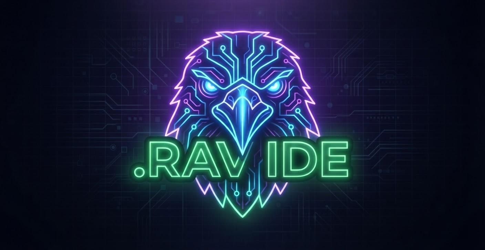
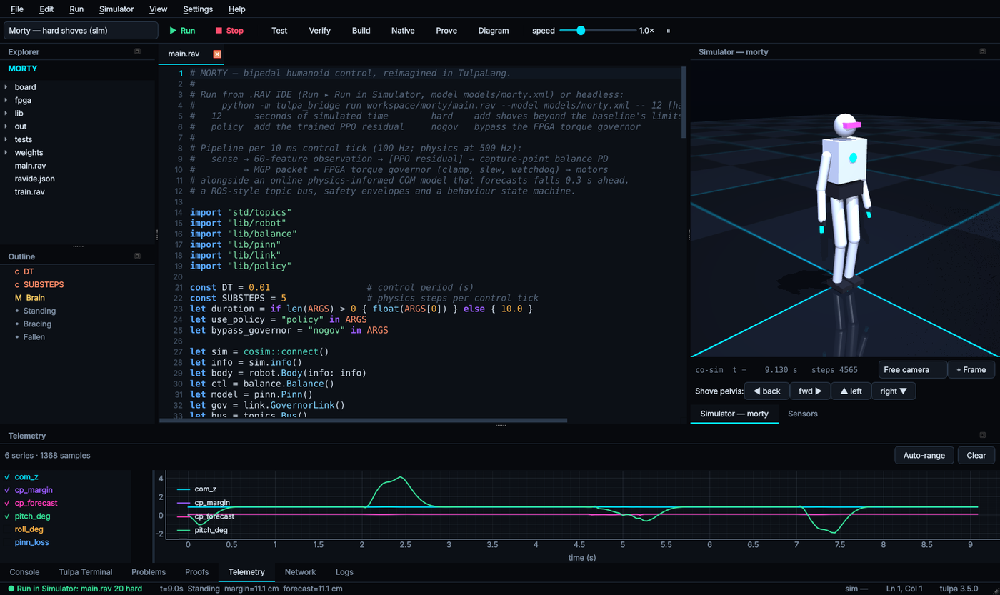
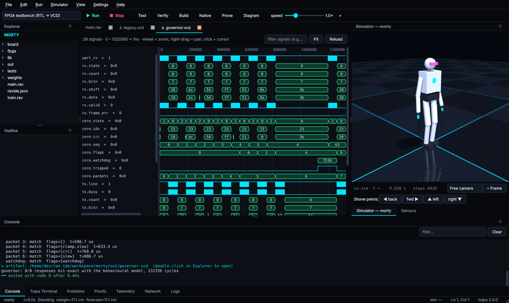
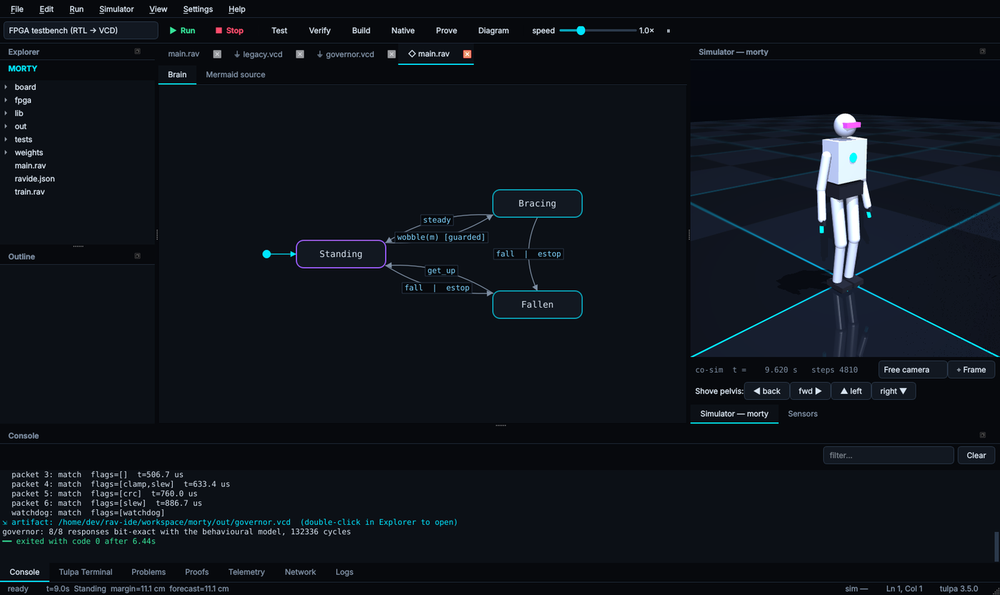

# .RAV IDE: simulation suite & IDE for TulpaLang

> Formerly **HermiSim**. Existing HermiSim installs, projects (`hermisim.json`) and the
> `Documents\HermiSim` folder keep working; the installer upgrades HermiSim in place.

.RAV IDE is an engineering workbench for writing robot software in
[TulpaLang](https://github.com/LoQiseaking69/TulpaLang) and testing it, all in one window:
- MuJoCo physics, driven in lock-step from Tulpa programs
- cycle-accurate RTL models, shown in a waveform viewer
- boards described as code
- live telemetry

The bundled **Morty** project rewrites the
[Morty bipedal humanoid](https://github.com/LoQiseaking69/Morty) entirely in Tulpa.

.webp)



## Features

| | |
|---|---|
| **Tulpa editor** | Syntax highlighting, a language-server client (`tulpa lsp`) with live diagnostics, hover, completion and go-to-definition, an outline, find/replace, and multiple tabs. |
| **Tulpa terminal** | A live `tulpa` REPL docked beside the console. `$ check main.rav` runs tulpa commands, `! cmd` runs shell commands, Ctrl+Enter sends the editor selection. |
| **Run configurations** | Run, Test (`define_test!`), Verify (contract fuzzing), Prove, Build (LLVM native object + header), Run Natively, Run on the Firmware VM, Build Firmware, Bundle, Deploy, Link Bridge, Bytecode and Diagram. Projects define their own configurations in `ravide.json` (the older `hermisim.json` is still read). |
| **Native & firmware (Tulpa 3.3)** | **Run ▸ Run Natively** (Ctrl+Shift+F5) compiles the whole program with `tulpa build --target sim --exe` and runs the executable. Use it to check that native output matches the interpreter. **Run ▸ Build Firmware for Board…** (Ctrl+Shift+B) builds for RP2040, ESP32, ESP32-S2/S3/C3/C6, Cortex-M or RISC-V. **Run ▸ New Firmware Project…** scaffolds a Pico SDK or ESP-IDF project with `tulpa new` and opens it. Driver SDK code (`interface`, `impl`, `std/driver`, `std/drivers/*`) is highlighted and documented under Help. |
| **Proofs (Tulpa 3.4)** | **Run ▸ Prove Contracts** (Ctrl+Alt+P) runs `tulpa prove` and lists every obligation in the **Proofs** dock: each `ensure`, `assert`, struct and loop invariant, call precondition and divisor, marked proved, refuted (with a counterexample) or unproved. Double-click to jump to the code. |
| **Deploy & bundle (Tulpa 3.4)** | **Run ▸ Deploy Project to Board…** runs `tulpa deploy` on a firmware project: prove, check on the simulator, build with the board SDK, flash. It has a dry-run mode. **Run ▸ Bundle Standalone Executable** makes one executable with the whole language for desktops and Linux boards. |
| **Network (Tulpa 3.4)** | The **Network** dock shows the Tulpa Link nodes on your LAN, with the topics they publish and subscribe to and the services they offer. |
| **The whole language on a microcontroller (Tulpa 3.5)** | **Build Firmware for Board…** takes any program: one that fits the static compiler becomes native code, and any other is built onto the Tulpa VM for firmware (the build output says which). **Run ▸ Run on the Firmware VM** (Ctrl+Alt+F5) builds that same VM for the simulated board and runs it, so you see exactly what the board will do. **Run ▸ Link Bridge to Board…** runs `tulpa link bridge` on a serial port (Linux), and a board whose Tulpa Link node uses its UART then shows up in the **Network** dock. The bundled **Firmware VM lab** project has a rover with a behaviour tree, a state machine and a node, with configurations for all three. |
| **Autonomy lab** | A second bundled project (next to Morty): mission planning and replanning, Tulpa Link on a simulated lossy network, a rover simulated through emulated chips and the real drivers, and contracts to prove. Open it from the Welcome page. |
| **Co-simulation** | One ▶ Run button runs the selected target (the current file or a project configuration); programs that call `cosim::connect()` start a MuJoCo session automatically. Each `sim.step(ctrl, n)` applies controls, advances physics and returns an observation: joints, sensors, COM, contacts. You can run as fast as possible or at real time ×N and shove bodies from the UI. The viewport shows the floor stage even before a model loads, and frames each model automatically (double-click or ⌖ Frame to re-frame). |
| **Live telemetry** | `tlm::plot("name", v)` streams to pyqtgraph plots. `tlm::status` drives the status bar. `tlm::artifact` links files the program produced. |
| **Waveform viewer** | Opens VCD files written by `std/rtl` (or Verilog simulators), with zoom, pan, a cursor and signal filtering. |
| **State-machine diagrams** | Renders every `machine` in the current file. |
| **BOM / netlist viewer** | Tables for the CSV/JSON that `std/eda` exports. |
| **Headless CLI** | `python -m tulpa_bridge run prog.rav --model m.xml` (or `ravide-cli` in the installed build) for CI. |
| **Classic viewer** | The original model viewer and model-builder wizard are still available with `--classic`. |

<p>
 
</p>

## Morty, reimagined in Tulpa

The original project combined:
- a ROS node with a PINN and an RL agent written in PyTorch
- Verilog modules for UART and the FPGA
- gEDA scripts for the mainboard

The rewrite keeps that architecture. Each piece is now something you can execute and check:

| Original | In Tulpa (`workspace/morty/`) |
|---|---|
| `rospinn.py` PINN, whose COM loss was the mean of its own outputs | `lib/pinn.rav` is an `nn::` model of COM dynamics. It is trained online on simulator data plus a residual from the **Linear Inverted Pendulum** physics model (`std/lipm`). It forecasts capture-point margin 0.3 s ahead. |
| `rospinn.py` RL "loss" `-log_prob.mean()` | `lib/policy.rav` and `train.rav` implement real PPO (`std/rl`, GAE, clipped objective). The policy outputs a residual on top of the controller. |
| — | `lib/balance.rav` is a capture-point balance controller (PD + ankle/hip strategy). |
| ROS topics | `std/topics` provides a typed publish/subscribe bus built on Tulpa signals, so `when`/`always` rules can watch topics. |
| `uart_comm.v`: a 10-bit counter that never reached 10416, and shared TX/RX state | `fpga/governor.rav` is a cycle-accurate RTL torque governor (`std/rtl`). It has 8N1 UART RX/TX, CRC-checked packets, clamp, slew limiting and a watchdog. `fpga/testbench.rav` checks it bit-exactly against `fpga/protocol.rav` and writes a VCD. `fpga/legacy.rav` ports the original CPU, FPGA and UART modules faithfully. |
| `mortymb.py` gEDA XML | `board/motherboard.rav` describes the board with `std/eda`: ERC, a power budget in watts back through the regulators, a netlist and a BOM with costs. |
| `main.py` (iverilog + rosrun) | `main.rav` runs the whole stack at 100 Hz: sense, then the 60-feature observation, then the policy, then the balance controller, then an MGP packet to the FPGA governor, then the motors. Safety envelopes and a behaviour state machine sit on top. |

Run it:

```bash
# in the IDE: open the Morty project and pick a run configuration, or headless:
python -m tulpa_bridge run workspace/morty/main.rav --model models/morty.xml -- 20 hard
python -m tulpa_bridge run workspace/morty/train.rav --model models/morty.xml -- 40   # PPO
cd workspace/morty && tulpa fpga/testbench.rav && tulpa board/motherboard.rav && tulpa test tests/morty_test.rav
```

## Install

### Windows

**[⬇ Download the latest installer](https://github.com/LoQiseaking69/HermiSim-DynamicsViewer/releases/latest)**:
`RAVIDE-Setup-<version>-x64.exe`. The installer:
- bundles the IDE, MuJoCo and the Tulpa toolchain
- can add `tulpa` to `PATH` and associate `.rav`/`.tlp` files
- installs per user without admin rights, or for all users

**Run Natively** and **Build Firmware** also need clang 14 or newer on `PATH`
(`winget install LLVM.LLVM`). Linking firmware also needs the board's SDK: the Pico SDK for
RP2040, or ESP-IDF 5.x for the ESP32 family.

Your editable projects go to `Documents\RAV IDE` (an existing `Documents\HermiSim` keeps being used). Each release lists its SHA-256 checksum and
whether it is code-signed; see [code signing](installer/windows/SIGNING.md).

### From source (Linux, macOS, Windows)

```bash
git clone https://github.com/LoQiseaking69/HermiSim-DynamicsViewer.git
git clone https://github.com/LoQiseaking69/TulpaLang.git
(cd TulpaLang && cargo build --release)          # .RAV IDE finds ../TulpaLang/target/release/tulpa
cd HermiSim-DynamicsViewer
pip install -r requirements.txt
python main.py                                   # IDE  (python main.py --classic for the old viewer)
python -m tulpa_bridge doctor                    # toolchain / MuJoCo check
```

You can point .RAV IDE at a specific toolchain with `TULPA_BIN`, or under *Settings ▸ Tulpa Toolchain*.

### Building the Windows installer

```powershell
powershell -ExecutionPolicy Bypass -File installer\windows\build.ps1 -TulpaSrc ..\TulpaLang -Version 2.3.0
```

The script:
1. builds Tulpa and the VS Code extension
2. stages the toolchain
3. renders the brand assets (`tools/make_brand_assets.py`, from `assets/logo/ravide-logo.jpg`)
4. builds the PyInstaller bundle (`installer/ravide.spec`) and smoke-tests it
5. compiles `installer/windows/ravide.iss` with Inno Setup 6

The `windows-installer` GitHub workflow does the same on every `v*` tag, or from *Run workflow*
with *publish* ticked. It signs the installer with Microsoft Artifact Signing once that is set
up ([SIGNING.md](installer/windows/SIGNING.md)), then publishes it to the Releases page. TulpaLang is private, so the workflow needs a `TULPA_REPO_TOKEN`
secret with read access to it.

## Layout

```
main.py                IDE entry (also `run`/`exec`/`doctor` CLI subcommands)
gui/ide/               IDE: window, editor, LSP-aware panels, plots, VCD and machine viewers, run manager
gui/                   classic viewer, renderer, model builder
physics_engine/        thread-safe MuJoCo engine + simulation state machine
tulpa_bridge/          toolchain discovery, co-sim server (JSON-lines over TCP), runner, LSP client
models/                morty.xml (18-actuator humanoid), starter_model.xml
workspace/morty/       Morty in Tulpa
assets/logo/           .RAV IDE circuit-raven logo (master JPG + rendered PNG/ICO/banner)
installer/             PyInstaller spec, Inno Setup script, build script, wizard art
tools/                 brand-asset renderer, headless IDE smoke test
tests/                 pytest: engine, file loader, telemetry/VCD, Tulpa co-sim end-to-end, native/firmware run kinds
```

## Tests

```bash
pytest                                                      # Tulpa-dependent tests skip if no toolchain
QT_QPA_PLATFORM=offscreen MUJOCO_GL=egl python tools/ide_smoke.py screens/   # IDE screenshots
```

## License

Business Source License 1.1 from version 2.3.0: free for development, evaluation, education, research and personal projects; commercial production use needs a license from HermiTech LLC; each version becomes Apache-2.0 four years after its release. See [LICENSING.md](LICENSING.md) and [LICENSE](LICENSE). Versions up to 2.2.0 remain BSD 3-Clause.
