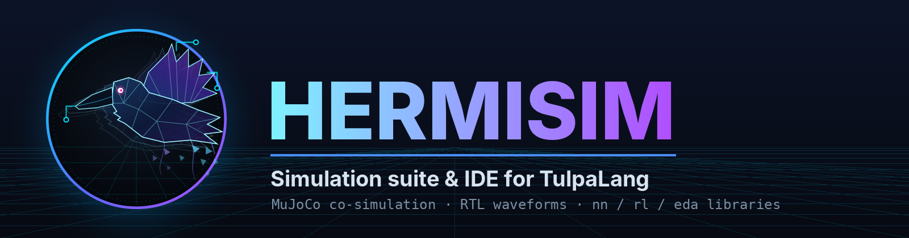
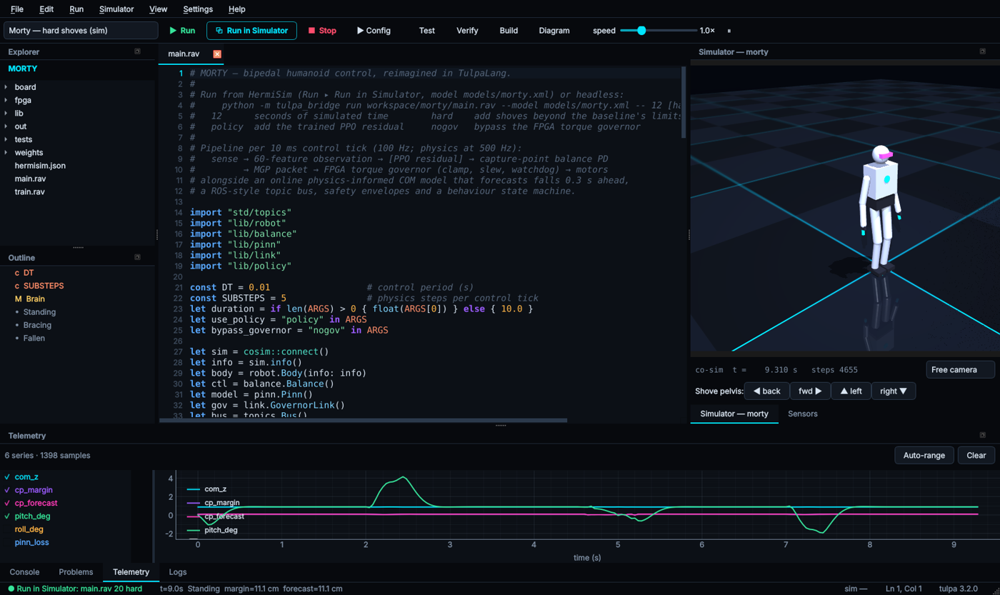
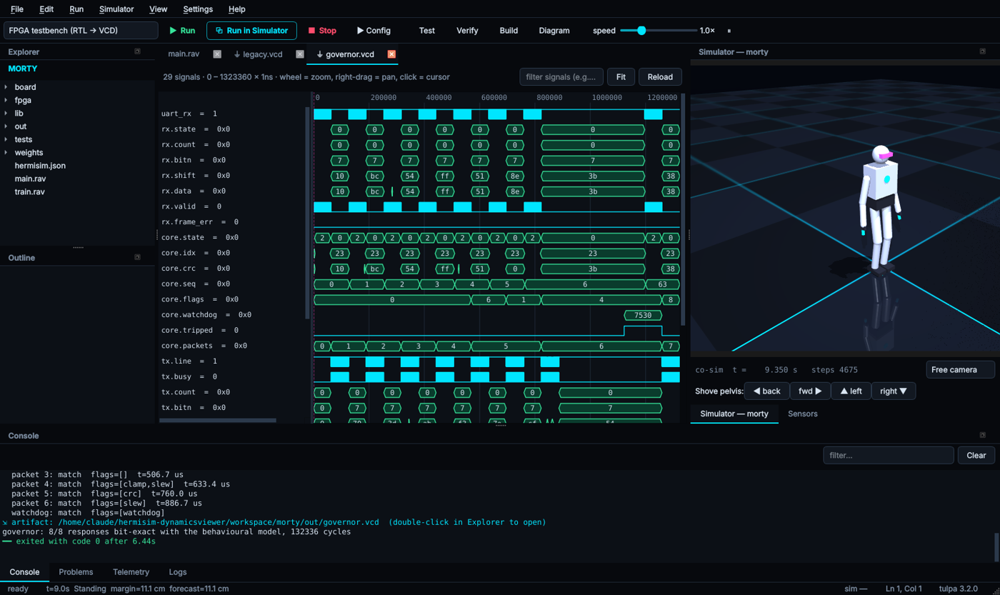
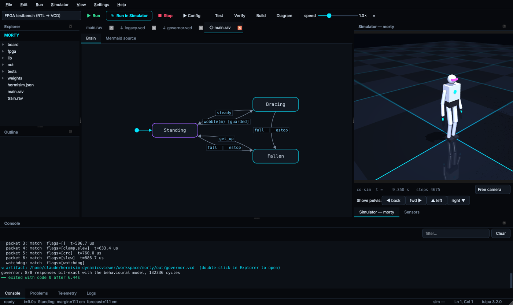

# HermiSim: simulation suite & IDE for TulpaLang

HermiSim is an engineering workbench for writing robot software in
[TulpaLang](https://github.com/LoQiseaking69/TulpaLang) and testing it, all in one window:
- MuJoCo physics, driven in lock-step from Tulpa programs
- cycle-accurate RTL models, shown in a waveform viewer
- boards described as code
- live telemetry

The bundled **Morty** project rewrites the
[Morty bipedal humanoid](https://github.com/LoQiseaking69/Morty) entirely in Tulpa.



## Features

| | |
|---|---|
| **Tulpa editor** | Syntax highlighting, a language-server client (`tulpa lsp`) with live diagnostics, hover, completion and go-to-definition, an outline, find/replace, and multiple tabs. |
| **Run configurations** | Run, Test (`define_test!`), Verify (contract fuzzing), Build (LLVM native object + header), Bytecode and Diagram. Projects define their own configurations in `hermisim.json`. |
| **Co-simulation** | *Run in Simulator* starts a MuJoCo session and the program connects with `cosim::connect()`. Each `sim.step(ctrl, n)` applies controls, advances physics and returns an observation: joints, sensors, COM, contacts. You can run as fast as possible or at real time ×N, shove bodies from the UI, and use a free camera. |
| **Live telemetry** | `tlm::plot("name", v)` streams to pyqtgraph plots. `tlm::status` drives the status bar. `tlm::artifact` links files the program produced. |
| **Waveform viewer** | Opens VCD files written by `std/rtl` (or Verilog simulators), with zoom, pan, a cursor and signal filtering. |
| **State-machine diagrams** | Renders every `machine` in the current file. |
| **BOM / netlist viewer** | Tables for the CSV/JSON that `std/eda` exports. |
| **Headless CLI** | `python -m tulpa_bridge run prog.rav --model m.xml` (or `hermisim-cli` in the installed build) for CI. |
| **Classic viewer** | The original model viewer and model-builder wizard are still available with `--classic`. |

<p>
 
</p>

## Morty, reimagined in Tulpa

The original project combined:
- a ROS node with a PINN and an RL agent written in PyTorch
- Verilog modules for UART and the FPGA
- gEDA scripts for the mainboard

The rewrite keeps that architecture. Each piece is now something you can execute and check:

| Original | In Tulpa (`workspace/morty/`) |
|---|---|
| `rospinn.py` PINN, whose COM loss was the mean of its own outputs | `lib/pinn.rav` is an `nn::` model of COM dynamics. It is trained online on simulator data plus a residual from the **Linear Inverted Pendulum** physics model (`std/lipm`). It forecasts capture-point margin 0.3 s ahead. |
| `rospinn.py` RL "loss" `-log_prob.mean()` | `lib/policy.rav` and `train.rav` implement real PPO (`std/rl`, GAE, clipped objective). The policy outputs a residual on top of the controller. |
| — | `lib/balance.rav` is a capture-point balance controller (PD + ankle/hip strategy). |
| ROS topics | `std/topics` provides a typed publish/subscribe bus built on Tulpa signals, so `when`/`always` rules can watch topics. |
| `uart_comm.v`: a 10-bit counter that never reached 10416, and shared TX/RX state | `fpga/governor.rav` is a cycle-accurate RTL torque governor (`std/rtl`). It has 8N1 UART RX/TX, CRC-checked packets, clamp, slew limiting and a watchdog. `fpga/testbench.rav` checks it bit-exactly against `fpga/protocol.rav` and writes a VCD. `fpga/legacy.rav` ports the original CPU, FPGA and UART modules faithfully. |
| `mortymb.py` gEDA XML | `board/motherboard.rav` describes the board with `std/eda`: ERC, a power budget in watts back through the regulators, a netlist and a BOM with costs. |
| `main.py` (iverilog + rosrun) | `main.rav` runs the whole stack at 100 Hz: sense, then the 60-feature observation, then the policy, then the balance controller, then an MGP packet to the FPGA governor, then the motors. Safety envelopes and a behaviour state machine sit on top. |

Run it:

```bash
# in the IDE: open the Morty project and pick a run configuration, or headless:
python -m tulpa_bridge run workspace/morty/main.rav --model models/morty.xml -- 20 hard
python -m tulpa_bridge run workspace/morty/train.rav --model models/morty.xml -- 40   # PPO
cd workspace/morty && tulpa fpga/testbench.rav && tulpa board/motherboard.rav && tulpa test tests/morty_test.rav
```

## Install

### Windows

Download `HermiSim-Setup-<version>-x64.exe` from
[Releases](https://github.com/LoQiseaking69/HermiSim-DynamicsViewer/releases). The installer:
- bundles the IDE, MuJoCo and the Tulpa toolchain
- can add `tulpa` to `PATH` and associate `.rav`/`.tlp` files
- installs per user without admin rights, or for all users

Your editable projects go to `Documents\HermiSim`.

### From source (Linux, macOS, Windows)

```bash
git clone https://github.com/LoQiseaking69/HermiSim-DynamicsViewer.git
git clone https://github.com/LoQiseaking69/TulpaLang.git
(cd TulpaLang && cargo build --release)          # HermiSim finds ../TulpaLang/target/release/tulpa
cd HermiSim-DynamicsViewer
pip install -r requirements.txt
python main.py                                   # IDE  (python main.py --classic for the old viewer)
python -m tulpa_bridge doctor                    # toolchain / MuJoCo check
```

You can point HermiSim at a specific toolchain with `TULPA_BIN`, or under *Settings ▸ Tulpa Toolchain*.

### Building the Windows installer

```powershell
powershell -ExecutionPolicy Bypass -File installer\windows\build.ps1 -TulpaSrc ..\TulpaLang -Version 2.0.0
```

The script:
1. builds Tulpa and the VS Code extension
2. stages the toolchain
3. renders the brand assets
4. builds the PyInstaller bundle (`installer/hermisim.spec`) and smoke-tests it
5. compiles `installer/windows/hermisim.iss` with Inno Setup 6

The `windows-installer` GitHub workflow does the same on every `v*` tag and attaches the
installer to the release. TulpaLang is private, so the workflow needs a `TULPA_REPO_TOKEN`
secret with read access to it.

## Layout

```
main.py                IDE entry (also `run`/`exec`/`doctor` CLI subcommands)
gui/ide/               IDE: window, editor, LSP-aware panels, plots, VCD and machine viewers, run manager
gui/                   classic viewer, renderer, model builder
physics_engine/        thread-safe MuJoCo engine + simulation state machine
tulpa_bridge/          toolchain discovery, co-sim server (JSON-lines over TCP), runner, LSP client
models/                morty.xml (18-actuator humanoid), starter_model.xml
workspace/morty/       Morty in Tulpa
assets/logo/           ghost-raven mark (SVG source + rendered PNG/ICO)
installer/             PyInstaller spec, Inno Setup script, build script, wizard art
tools/                 brand-asset renderer, headless IDE smoke test
tests/                 pytest: engine, file loader, telemetry/VCD, Tulpa co-sim end-to-end
```

## Tests

```bash
pytest                                                      # Tulpa-dependent tests skip if no toolchain
QT_QPA_PLATFORM=offscreen MUJOCO_GL=egl python tools/ide_smoke.py screens/   # IDE screenshots
```

## License

BSD 3-Clause. See [LICENSE](LICENSE).
